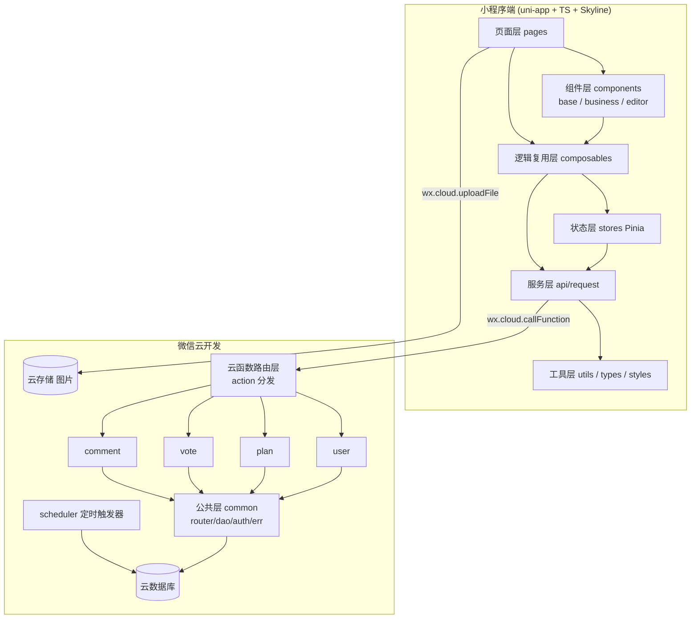

# Decide（暂定名「众议」）微信小程序 · 技术方案

> 版本：v1.0　编写日期：2026-11-12
> 技术栈：uni-app + TypeScript + Skyline 渲染引擎 + 微信云开发（云函数 / 云数据库 / 云存储）
> 本文档只做设计，不含实现代码；实现按第 12 章的任务拆分逐个推进。

---

## 1. 项目概述

### 1.1 产品定位

一个「计划公示 + 群体表决」的轻社交小程序：

- **主态（发布者）**：发布一个计划，用富文本描述内容与配图，设定截止时间，可附带若干「选项卡片」，实时查看赞同/反对比例与评论。
- **客态（参与者）**：浏览计划列表，进入详情阅读，对计划投赞同票或反对票，发表评论。

### 1.2 需求清单（对应原始 5 条）

| 编号 | 需求 | 落地模块 |
| --- | --- | --- |
| R1 | 主态发布计划：富文本编辑器、最多 3 张图片、展示赞同/反对投票结果、顺序展示评论 | 编辑器页、计划详情页、`plan`/`comment` 云函数 |
| R2 | 客态进入后可评论、可赞同/反对 | 详情页交互区、`vote`/`comment` 云函数 |
| R3 | 发布时可设截止时间；首页列表展示倒计时 + 赞同/反对比例 | 首页卡片、`CountDown`、`VoteRatioBar` |
| R4 | 发布编辑时可开启「选项」开关，开启后顺序展示选项卡片，可配置名称 + 最多 1 张配图 | 编辑器「选项」区块、详情页 `OptionCardList` |
| R5 | 我的页：上方用户信息 + 「发起/参与/进行中」数据，下方按筛选卡片筛选业务列表 | 我的页、`StatCards`、`FilterTabs`、复用的 `PlanList` |

### 1.3 非目标（v1 明确不做）

- 不做关注/粉丝体系、私信聊天、话题广场。
- 不做多端（仅微信小程序），H5/App 端不保证可用。
- 不做匿名投票、不做投票撤回后的历史留痕展示。
- 不做后台管理系统（用云开发控制台 + 少量运维云函数代替）。

---

## 2. 技术选型与关键约束

### 2.1 选型说明

| 层 | 选型 | 理由 |
| --- | --- | --- |
| 框架 | uni-app（Vue 3 + `<script setup>` + TS） | 团队熟悉、生态成熟、条件编译便于处理小程序差异 |
| 渲染 | Skyline（微信自研） | 原生级滚动/动画性能，长列表与倒计时刷新更顺滑 |
| 状态 | Pinia | Vue3 官方推荐，配合 composable 做「页面级临时状态」 |
| 样式 | SCSS + 设计变量（Design Token） | 统一色板/间距/圆角，便于换肤 |
| 后端 | 微信云开发云函数（Node 16+，TypeScript 编写） | 免运维、天然拿到 `OPENID`、与小程序鉴权打通 |
| 存储 | 云数据库（文档型）+ 云存储（图片 fileID） | 与云函数同域，图片可直接用 fileID 渲染 |

### 2.2 Skyline 关键约束（**设计前必须遵守**）

1. **全局开关**：`manifest.json → mp-weixin` 配置 `"renderer": "skyline"`、`"componentFramework": "glass-easel"`、`rendererOptions.skyline`；`lazyCodeLoading: "requiredComponents"`。
2. **页面禁用默认滚动**：Skyline 下页面本身不滚动，所有滚动必须由 `<scroll-view>`（配合 `type="list"` / `nested`）承担；页面根节点使用 flex 纵向布局，`overflow: hidden`。
3. **CSS 子集（T0 已实测，见《docs/Skyline兼容清单.md》）**：`display: inline-block` **不生效**（节点纵向堆叠）；`-webkit-line-clamp` **不生效**（多行截断需 JS 截字或单行 ellipsis）；`scroll-view` 的 `scroll-top` **不生效**，`scroll-into-view` 生效。实测**可用**：`position: fixed`、`text-overflow: ellipsis`、`flex:1`、`rpx`、`vw/vh`、`word-break: break-all`、`transform`、`box-shadow`、`linear-gradient`、`border-radius + overflow:hidden` 裁剪、`z-index`、`opacity`、后代/子代选择器与 `::after`（模拟器实测生效，但官方文档声明不支持，**编码规范仍按不支持执行**，避免真机翻车）。所有文字必须包在 `<text>` 内。
4. **布局以 Flex 为主**：默认 `display: block` 需显式开启 `defaultDisplayBlock`；margin 在 flex 容器下不折叠（实测相邻 20px+20px = 40px）。
5. **动画（T0 已实测）**：CSS `transition: transform` **可用**（方块平滑位移实测通过）。`wx.worklet` 存在且 API 齐全（`shared/timing/spring/decay/Easing/runOnUI/cancelAnimation/derived/delay/repeat/sequence/snapshotContext/scrollViewContext/getBoundingClientRect`），但 **SharedValue 无法通过 Vue 模板的 style 承载**（拼接结果为 `[object Object]`），必须放在 `wxcomponents` 原生组件内用 `applyAnimatedStyle` 绑定。**默认策略：交互动画一律 CSS transition；确需 worklet 的场景（跟手手势）单独封装原生组件。**
6. **`<editor>` 确认不可用（T0 已实测）**：组件能渲染出盒子且 `canIUse('editor')=true`，但 `bindready` 永不触发、`EditorContext` 取不到 → 无法读写内容。这是本方案富文本采用「自研块编辑器」的直接原因（见 §8.1）。`rich-text` 可用但**内联流被打断**（HTML 中每个行内节点独占一行），因此详情页正文也不走 `rich-text`，与编辑器共用自研块渲染器。
7. **Skyline 专属组件（T0 已实测，首屏内逐个隔离挂载）**：可用 = `scroll-view type=list`、`page-container`、`root-portal`、`share-element`、`draggable-sheet`、`snapshot`、`open-container`、`scroll-view type=nested`；**不可用 = `list-view`、`grid-view`、`sticky-section/sticky-header`（渲染为 0×0）**。另注意 `scroll-view type="list"` 会虚拟化视口外节点，**对未渲染节点调用 `boundingClientRect` 会挂起不回调**，业务代码禁止测量视口外节点。首页/我的页一律用 `scroll-view type=list` + flex 布局，吸顶用 `position: fixed` 头部实现。
8. **单页面降级能力**：微信支持在 page json 中单独声明 `"renderer": "webview"`。**兜底策略**：若编辑器页在 Skyline 下受限过多，仅该页降级为 webview，其余页面保持 Skyline。

> 结论：T0 技术预研已完成（模拟器实测，结论见《docs/Skyline兼容清单.md》）。剩余未决项仅两类：**云能力三项**（等云开发环境开通）与**真机复核**（模拟器通过 ≠ 真机通过，M0 里程碑内用真机跑一遍兼容清单）。

---

## 3. 系统架构



**分层原则**

- 页面只做「编排 + 路由参数解析」，不写业务计算。
- 组件不直接调云函数，通过 props/emits 或注入的 composable 交互（业务组件可用 composable）。
- 所有云端调用必须经过 `api/request.ts` 唯一出口，禁止页面里裸调 `wx.cloud`。
- 云函数内部：`路由层 → 服务层 → DAO 层`，DAO 层是唯一接触数据库的地方。

---

## 4. 目录结构

```text
Decide/
├── docs/                        # 设计文档（本文件所在处）
│   └── 技术方案.md
├── src/                         # 小程序源码
│   ├── App.vue
│   ├── main.ts
│   ├── manifest.json            # Skyline / 云开发 envId 配置
│   ├── pages.json               # 路由、tabBar、每页 renderer 与导航配置
│   ├── uni.scss                 # 全局 SCSS 变量入口
│   ├── pages/
│   │   ├── home/index.vue               # 首页：计划列表 + 倒计时 + 比例 + FAB
│   │   ├── plan/detail.vue              # 计划详情：内容/投票/选项/评论
│   │   ├── plan/edit.vue                # 发布/编辑计划（块编辑器宿主）
│   │   ├── mine/index.vue               # 我的：用户信息 + 统计 + 筛选列表
│   │   └── common/webview.vue           # 协议/帮助等静态页（可选）
│   ├── components/
│   │   ├── base/                # 通用基础组件（无业务语义）
│   │   ├── business/            # 业务组件（含业务语义，可跨页复用）
│   │   └── editor/              # 富文本编辑器专用组件
│   ├── composables/             # 逻辑复用（use*）
│   ├── stores/                  # Pinia
│   ├── api/                     # 云函数调用封装（按域拆分）
│   ├── types/                   # 全局 TS 类型（含与云函数共享的 DTO）
│   ├── constants/               # 枚举、错误码、配置常量
│   ├── utils/                   # 纯函数工具
│   └── styles/                  # token / mixin / 全局样式
├── cloudfunctions/              # 云函数根目录（project.config.json 指向此处）
│   ├── common/                  # 公共模块（被各云函数以 file:../common 引用）
│   │   ├── router.js            # action 路由 + 参数校验 + 统一响应
│   │   ├── auth.js              # openId 获取、权限校验
│   │   ├── errors.js            # 错误码与业务异常
│   │   ├── dao/                 # 各集合数据访问
│   │   └── validate.js          # 轻量 schema 校验
│   ├── user/
│   ├── plan/
│   ├── vote/
│   ├── comment/
│   └── scheduler/               # 定时触发器：过期计划状态流转 + 订阅消息
├── shared/                      # 前后端共享的「常量与结构定义」（编译期复制）
│   ├── constants.ts
│   └── schema.ts
├── scripts/
│   ├── build-cloud.ts           # 云函数 TS → JS 就地编译 + shared 注入
│   └── check-env.ts             # 环境自检（envId、依赖版本）
├── package.json
├── tsconfig.json
└── .eslintrc / .prettierrc / .editorconfig
```

**约定**

- 目录名 kebab-case；Vue 组件文件名 PascalCase（`PlanCard.vue`），页面文件 index.vue/detail.vue。
- 组件目录内聚：`components/business/PlanCard/{index.vue, types.ts, style.scss}`，对外只导出 `index.vue`。
- `shared/` 不直接被云函数 import（云函数无法解析 src 路径），由 `build-cloud.ts` 在编译期复制为 `cloudfunctions/common/shared.js`。

---

## 5. 数据模型设计

> 云数据库集合。所有集合**关闭前端直接读写权限**（安全规则设为「仅管理端可读写」），一切读写经云函数，杜绝刷票与越权。
>
> T0.2 实测补充：集合名**不能以下划线开头**，≤96 字符，只允许字母/数字/下划线/连字符（本节命名全部合规）；云函数侧 `db.createCollection()` 可用，但 **SDK 没有 `dropCollection`**，删集合只能控制台操作，因此建表脚本要幂等且谨慎；**索引无法用 SDK 创建**，T2.1 必须控制台手建；事务（`startTransaction` / `commit`）、`serverDate()`、`where+orderBy+limit`、`count`、`doc.remove` 均已实测可用，投票去重与计数扣减可以放心走事务。

### 5.1 `users` 用户

| 字段 | 类型 | 说明 |
| --- | --- | --- |
| `_id` | string | 文档 ID |
| `openId` | string | 唯一索引，来自云函数上下文 |
| `nickName` | string | 昵称（用户授权后写入） |
| `avatarUrl` | string | 头像（云存储 fileID 或 https） |
| `status` | number | 0 正常 / 1 禁言 / 2 封禁 |
| `stats` | object | `{ created: 发起数, joined: 参与数, ongoing: 进行中数 }`，异步冗余，允许短暂不一致 |
| `createdAt` / `updatedAt` | number | 毫秒时间戳 |

索引：`openId`（唯一）。

### 5.2 `plans` 计划

| 字段 | 类型 | 说明 |
| --- | --- | --- |
| `_id` | string | |
| `openId` | string | 作者 openId，索引 |
| `title` | string | 标题，≤ 40 字 |
| `summary` | string | 摘要，由 blocks 纯文本截取前 60 字，**列表页展示用，避免拉全量 content** |
| `blocks` | array | 富文本块数组（结构见 §8.1），仅详情页读取 |
| `images` | array\<string\> | 计划配图 fileID，**长度 ≤ 3** |
| `deadline` | number | 截止时间戳；0/缺失表示不限制 |
| `optionsEnabled` | boolean | 「选项」开关，默认 false |
| `options` | array | `[{ id, name, image, order }]`，`optionsEnabled=false` 时忽略；name ≤ 20 字，image 最多 1 张 |
| `vote` | object | `{ agree: number, disagree: number }` 计数冗余，供列表比例展示 |
| `commentCount` | number | 评论数冗余 |
| `status` | number | 0 草稿 / 1 进行中 / 2 已截止 / 3 已删除（软删） |
| `createdAt` / `updatedAt` | number | |

索引：
- `status + createdAt(desc)`：首页列表分页。
- `openId + status + createdAt(desc)`：我的-我发起的。
- `vote.agree + vote.disagree`：无需索引，投票时 `_.inc(1)` 原子更新。

> 一致性策略：`vote`/`commentCount` 为**冗余计数**，写入 `votes`/`comments` 时在同一云函数内用 `_.inc()` 原子更新；每日由 `scheduler` 做一次对账修正（`plan_recount` action）。

### 5.3 `votes` 投票

| 字段 | 类型 | 说明 |
| --- | --- | --- |
| `planId` | string | |
| `openId` | string | |
| `type` | number | 1 赞同 / 2 反对 |
| `createdAt` / `updatedAt` | number | |

索引：**`planId + openId` 唯一索引** —— 数据库层面兜底防重复投票；改票即 `update` 该文档的 `type`，同时反向调整 `plans.vote` 计数。

### 5.4 `comments` 评论

| 字段 | 类型 | 说明 |
| --- | --- | --- |
| `planId` | string | 索引 |
| `openId` | string | 评论人 |
| `content` | string | 纯文本，≤ 500 字 |
| `seq` | number | 顺序号（同一 plan 内自增），保证「顺序展示」稳定 |
| `status` | number | 0 正常 / 1 已删除（占位显示「评论已删除」） |
| `createdAt` | number | |

索引：`planId + seq(asc)`；分页游标用 `seq`。

> v1 评论为**单层顺序流**（不做二级回复），完全满足「顺序展示评论信息」。`replyTo` 字段预留但不实现 UI。

### 5.5 `counters` 自增序列

`{ _id: 'comment:{planId}', value: number }`，用 `_.inc(1)` + 读回实现评论 `seq` 自增（云开发无原生自增序列）。

---

## 6. 云函数设计

### 6.1 组织方式：按域聚合 + action 路由

**一个业务域 = 一个云函数**（而不是一个 action 一个函数）。原因：减少函数数量与冷启动实例分散、便于共享校验逻辑、部署更快。

```text
plan 云函数
  ├── action: create      创建计划
  ├── action: update      编辑（仅作者，草稿/进行中可改）
  ├── action: remove      软删除
  ├── action: detail      详情（含 blocks / 当前用户投票态）
  ├── action: list        公开列表（游标分页，不返回 blocks）
  ├── action: myList      我的列表（按 filter 分支）
  └── action: stats       我的页统计数据
```

### 6.2 统一响应与错误码

```ts
// shared/schema.ts
interface ApiResult<T = unknown> {
  code: number        // 0 成功；非 0 见错误码表
  message: string     // 可直接 toast 的中文文案
  data: T
  serverTime: number  // 服务端毫秒时间戳，用于倒计时校准
}
```

| code | 含义 | 前端处理 |
| --- | --- | --- |
| 0 | 成功 | — |
| 1001 | 参数校验失败 | toast message |
| 1002 | 未登录 / openId 缺失 | 静默重登后重试一次 |
| 2001 | 无权限（非作者） | toast + 返回 |
| 3001 | 资源不存在 | toast + 返回上一页 |
| 3002 | 计划已截止，不可投票/评论 | toast + 刷新详情态 |
| 3003 | 重复操作（重复投票） | 静默纠正本地态 |
| 4001 | 频率限制 | toast「操作太频繁」 |
| 5000 | 服务端异常 | toast + 上报 |

### 6.3 公共层 `common/`

- `router.js`：`createRouter(handlers)` → 解析 `event.action`、执行参数校验、包裹 try/catch、统一返回 `ApiResult`、统一日志（含 openId、action、耗时）。
- `auth.js`：`getOpenId()` 只从 `cloud.getWXContext().OPENID` 取值，**永不信任前端传入的 openId**；`assertAuthor(plan, openId)`。
- `validate.js`：轻量规则校验（required / maxLen / inEnum / isImageFileID / arrayMax）。
- `errors.js`：`BizError(code, message)`。
- `dao/`：`planDao`、`voteDao`、`commentDao`、`userDao`，封装查询构造与字段裁剪（`field()`），是唯一 `db.collection()` 出口。
- `ratelimit.js`：基于 `openId + action` 的内存/DB 计数限流（写操作 5 次/10 秒）。

### 6.4 关键接口契约（前端视角）

| action | 入参 | 出参 data |
| --- | --- | --- |
| `user.login` | `{ nickName?, avatarUrl? }` | `{ userInfo, isNew }` |
| `user.updateProfile` | `{ nickName, avatarUrl }` | `{ userInfo }` |
| `user.stats` | `{}` | `{ created, joined, ongoing }` |
| `plan.create` | `{ title, blocks, images[≤3], deadline, optionsEnabled, options[] }` | `{ planId }` |
| `plan.update` | `{ planId, ...同上 }` | `{ ok: true }` |
| `plan.detail` | `{ planId }` | `{ plan(全字段), author, myVote, serverTime }` |
| `plan.list` | `{ cursor?, pageSize=10 }` | `{ list[摘要字段], nextCursor, hasMore }` |
| `plan.myList` | `{ filter: 'created'|'joined'|'ongoing'|'ended', cursor?, pageSize }` | 同上 |
| `vote.submit` | `{ planId, type: 1|2 }` | `{ vote: {agree, disagree}, myVote: type }` |
| `comment.create` | `{ planId, content }` | `{ comment }` |
| `comment.list` | `{ planId, cursorSeq?, pageSize=20 }` | `{ list, nextCursor, hasMore }` |
| `comment.remove` | `{ commentId }` | `{ ok: true }`（作者或本人可删） |

### 6.5 分页策略

统一**游标分页**（不用 `skip`）：

- 列表游标 = `createdAt + _id` 组合（`where createdAt < c OR (createdAt == c AND _id < id)`），排序 `createdAt desc, _id desc`。
- 评论游标 = `seq`，排序 `seq asc`，天然满足「顺序展示」。
- `pageSize` 默认 10，上限 20。

### 6.6 云函数 TypeScript 编写与上传（已按 T0.2 实测修正）

- 源码：`cloudfunctions/<fn>/src/index.ts`，就地编译到 `cloudfunctions/<fn>/index.js`（`main: index.js`）。
- **tsconfig 必须用 `files` 不能用 `include`**：`rootDir: "src"` + `outDir: "."` 时，outDir 会被 TS 加进默认 exclude，`include: ["src/**/*.ts"]` 直接报 `TS18003 No inputs were found`；写成 `"files": ["src/index.ts"]` 可绕过 exclude。
- 依赖：`wx-server-sdk@^4.0.2`（npm latest）。教程里的 `~2.6.3` 类型更残缺，不要用。
- **类型缺陷要在边界收窄**（4.0.2 实测）：`openapi` 是 `Record<string, any>`，无接口级类型；`cloud.init({ env: cloud.DYNAMIC_CURRENT_ENV })` 报 symbol ≠ string，需断言；database 的 `add/get/count/remove` 返回 `string | void | IXxxResult` 联合（回调与 Promise 重载混写），await 后必须断言成真实结果类型；SDK **没有 `dropCollection`**，删集合只能去控制台。
- 每个函数目录带 `config.json`（`permissions.openapi` 声明 + `timeout` + `memorySize`）。**注意：`timeout` 通过 CLI 部署不生效**（部署后 `functions info` 仍显示默认 3s），只能控制台改 —— 凡是可能超 3s 的函数（批量结算、聚合统计）上线前必须逐个确认。
- 部署：**不用 `cloudfunctionRoot`，用 `--paths`**。uni-app 产物的 `project.config.json` 里没有 `cloudfunctionRoot`；它虽是 manifest 穿透键，但会相对产物目录解析成 `dist/build/mp-weixin/cloudfunctions`，与源码目录不符。

```bash
# 编译
cd cloudfunctions/<fn> && ../../node_modules/.bin/tsc -p tsconfig.json
# 部署（依赖云端安装，只上传源码与 package.json，实测 6 文件 / 15.8 KB）
/Applications/wechatwebdevtools.app/Contents/MacOS/cli cloud functions deploy \
  --env cloud1-d2g9acyyhb220d834 \
  --paths <绝对路径>/cloudfunctions/<fn> \
  --remote-npm-install \
  --project <绝对路径>/dist/build/mp-weixin
```

- **首次部署会失败一次**：函数不存在时先创建再传码，报 `FailedOperation.UpdateFunctionCode：当前函数处于 Creating 状态`。原样重试即成功，`scripts/build-cloud.ts` 里要内置一次重试。
- `packOptions.ignore` 仍要排除 `cloudfunctions/**/src/**`、`**/*.ts`、`**/tsconfig.json`，避免打进小程序包（`cloudfunctions/` 放在工程根，不在 `src/` 下，本身不参与 uni-app 编译）。
- 运行时：Nodejs16.13。集合名**不能以下划线开头**，≤96 字符，仅字母/数字/下划线/连字符。

### 6.7 定时触发器 `scheduler`

- 每 1 分钟：`status=1 && deadline>0 && deadline<=now` → 批量置 `status=2`（每次最多 100 条，循环直到无数据）。
- 每天 04:00：计数对账（重算 `vote` / `commentCount`）。
- 截止前 30 分钟：给作者发订阅消息（v2 迭代，v1 预留 action）。

---

## 7. 前端服务层与状态设计

### 7.1 `api/request.ts`（唯一云端出口）

职责：

1. `call<T>(fn, action, data)` → `wx.cloud.callFunction`，条件编译包裹（`#ifdef MP-WEIXIN`）。
2. **拦截器链**：请求前注入（无需注入 openId，云端自取）；响应后统一解包 `ApiResult`。
3. `serverTime` 校准：每次响应更新 `appStore.timeOffset = serverTime - Date.now()`。
4. 错误处理：`code=1002` 触发静默重登并重试 1 次；`code>=5000` 上报 + toast；其余 toast `message`。
5. 超时 8s + 一次重试（仅幂等 GET 类 action：detail/list/stats/comment.list）。
6. 并发去重：相同 `fn+action+序列化参数` 在飞行中复用同一 Promise。

按域拆分：`api/user.ts`、`api/plan.ts`、`api/vote.ts`、`api/comment.ts`，全部导出**强类型函数**，页面/组件不感知 action 字符串。

### 7.2 Pinia Stores

| store | 持久化 | 内容 |
| --- | --- | --- |
| `useAppStore` | 部分 | `timeOffset`、`sysInfo`、`safeArea`、主题、全局 loading |
| `useUserStore` | 是（storage 带过期） | `userInfo`、`isLoggedIn`、`stats`、`login()`/`refresh()` |
| `usePlanStore` | 否 | 列表缓存（首页/我的分别缓存）、`nextCursor`、**投票态映射 `myVotes: Record<planId, type>`**、`voteCounts: Record<planId, {agree,disagree}>` |

> `usePlanStore` 的投票态映射是**跨页一致性的关键**：详情页投票后写入 store，返回列表页时卡片比例与我的投票态自动同步，无需重新请求列表。

### 7.3 Composables（逻辑复用层）

| composable | 职责 |
| --- | --- |
| `useServerNow()` | 返回校准后的当前时间 ref，内部单一 ticker |
| `useCountdown(deadline)` | 输出 `{ text, level, expired, percent }`，**分级精度降频**（见 §8.5） |
| `usePagingList(fetcher)` | 分页列表通用逻辑：`list / loading / refreshing / hasMore / loadMore / reload / appendItem / patchItem`，含并发锁与错误回滚 |
| `useVote(planId)` | 投票/改票：乐观更新 → 调用 → 失败回滚，写入 `planStore` |
| `useComments(planId)` | 评论分页 + 发表 + 删除，基于 `usePagingList` |
| `useUpload(opts)` | 图片选择/压缩/上传/进度/删除，统一限制数量与格式 |
| `useEditor()` | 块编辑器状态机：blocks 增删改、选区、样式应用、序列化/反序列化、脏检查 |
| `useForm(rules)` | 表单校验、提交锁、草稿本地缓存 |
| `usePageRefresh()` | onShow 时的差异化刷新（数据是否过期） |
| `useShare()` | 分享配置（onShareAppMessage / 朋友圈） |
| `useToast() / useModal()` | 命令式调用基础反馈组件 |

---

## 8. 核心功能实现方案

### 8.1 R1 · 富文本编辑器（重点）

#### 为什么不用 `<editor>`

微信 `<editor>` 组件在 Skyline 下不受支持，且其产出 HTML 在小程序内只能用 `rich-text` 渲染，样式与交互不可控。**T0 实测补强**：Skyline 1.4.23 下 `<editor>` 能渲染出盒子、`canIUse('editor')` 为 true，但 `bindready` 永不触发、`EditorContext` 取不到，即完全无法读写内容；同时 `rich-text` 虽能渲染但**内联流被打断**（HTML 里每个行内节点各占一行）。**方案：自研「块编辑器（Block Editor）」**，数据为结构化 JSON，渲染由自有组件完成，Skyline 原生兼容，编辑态与展示态共用一套渲染分片逻辑。

#### 数据结构

```ts
type Block =
  | { id: string; type: 'text';  text: string; level: 1|2|3; align: 'left'|'center'; bold?: boolean; color?: string }
  | { id: string; type: 'image'; fileID: string; w: number; h: number; caption?: string }
  | { id: string; type: 'quote'; text: string }
  | { id: string; type: 'divider' }
```

- `level`：1=标题、2=小标题、3=正文，控制字号/字重。
- **样式为段落级**（`bold` / `color` 作用于整段）。T0 实测：`textarea` 的 `selectionchange` 事件 `canIUse` 为 false，且设置 `selection-start/selection-end` 后**无任何选区高亮**，拿不到可靠区间 → 区间样式（marks）方案废弃，不做。
- 图片以 `fileID` 存储，`w/h` 用于渲染前占位，**避免图片加载导致列表跳动**。

#### 页面结构（`pages/plan/edit.vue`）

```
自定义导航栏（返回 / 标题「发布计划」/ 发布按钮）
scroll-view (type=list, flex:1)
  ├─ 标题输入（textarea，单行高度自适应，≤40 字，字数计数）
  ├─ EditorBlockList          ← 块列表（可滚动区内）
  ├─ ImageUploader            ← 计划配图，最多 3 张（九宫格式）
  ├─ DeadlinePicker           ← 截止时间（快捷：1天/3天/7天/自定义 picker）
  └─ OptionsSection           ← 「添加选项」开关 + 选项卡片编辑区（R4）
底部工具栏（fixed，位于 scroll-view 之外）
  └─ EditorToolbar：正文/标题切换、加粗、颜色、对齐、插入图片、插入引用、插入分割线
```

#### 交互与选区

- 每个 text 块 = 一个 `<textarea>`（`auto-height`、`adjust-position`、`cursor-spacing`，三者 T0 实测均可用；2000 字长文本 auto-height 撑开正常），聚焦时工具栏作用于该块。
- 工具栏样式为**段落级**：加粗/颜色/对齐/级别直接改写当前聚焦块的字段，无需选区。T0 已确认 Skyline 下拿不到 textarea 选区区间，故不提供「选中部分文字加粗」能力。
- 块操作：长按块 → ActionSheet（上移/下移/删除/复制/设为标题）；末尾空块自动补一个空 text 块。
- 图片块：`useUpload` 选择后立即占位（本地路径）→ 上传中显示进度 → 成功后替换为 fileID；失败可重试。

#### 草稿与脏检查

- `useForm` + `useEditor` 提供 `isDirty`；每次内容变更 debounce 1.5s 写入 `storage`（key: `plan_draft_{openId}`）。
- 返回时若 `isDirty` → Modal「保存草稿 / 放弃 / 继续编辑」。
- 进入编辑页时：有 `planId` 走 `plan.detail` 回填；无则尝试恢复草稿。

#### 内容渲染器（详情页复用）

`components/business/ContentRenderer`：输入 `blocks`，输出只读视图。与编辑器共用同一套块类型与渲染逻辑（`utils/blocks.ts` 提供 `blockStyle(block)` 把 level/bold/color/align 映射为 `<text>` 内联样式），**编辑与渲染共用一份解析代码**，避免两处实现漂移。T0 实测该「原生 `<text>` 分片 + 内联样式」路线内联流正常、样式保真，优于 `rich-text`。

### 8.2 R1 · 图片上传（最多 3 张）

`useUpload({ max: 3, sizeType: ['compressed'], sourceType: ['album','camera'] })`：

1. `wx.chooseMedia` 选择（超出上限时 toast 并截断）。
2. 本地路径先行渲染占位 + 进度条。
3. `wx.cloud.uploadFile` 上传至 `plans/{openId}/{ts}_{rand}.{ext}`。
4. 返回 `fileID`，写入表单；删除即从数组移除（不做云端删除，由 scheduler 定期清理孤儿文件，v2）。
5. 安全限制：仅允许 jpg/png/webp，单张 ≤ 5MB，前端校验 + 云函数 `validate` 二次校验（`images.length <= 3` 且必须是本环境 fileID 前缀）。

> T0.7 实测（模拟器）：`uploadFile` 返回 `statusCode: 204`，fileID 形如 `cloud://cloud1-d2g9acyyhb220d834.636c-<env>-1530577071/t0/probe-<ts>.png`；`getTempFileURL` 返回带签名的 `https://636c-<env>-<id>.tcb.qcloud.la/...?sign=&t=`，`status:0 / errMsg:ok`。
> **关键差异**：小程序端 `wx.cloud.downloadFile` 返回 `{tempFilePath, statusCode, dataLength, header, cookies, errMsg}`，**没有 `fileContent`**（那是云函数侧 SDK 的字段，云函数里取到的才是 Buffer）。所以第 2 步的占位渲染直接用 `chooseMedia` 的本地路径，需要回读云端文件时用 `tempFilePath`，别按 `fileContent` 写代码。
> `<image src>` 用 fileID 还是临时 URL：Skyline 下两者都要真机复核；fileID 免签名过期，优先用 fileID。

### 8.3 R1/R2/R3 · 投票与比例展示

#### 组件 `VoteRatioBar`

- props：`agree`、`disagree`、`size: 'sm'|'md'|'lg'`、`showCount`、`animated`。
- 视觉：一条双色比例条（赞同色 / 反对色）+ 两端百分比文字 + 计数。
- 总数为 0 时显示灰色空态「暂无人表态」。
- Skyline 下宽度动画用 worklet（`transform: scaleX` 优于改 width，减少重排）；不支持则直接切换无动画。

#### 组件 `VoteActions`

- 两个按钮：赞同 / 反对；已选中态高亮 + 图标填充。
- 点击已选项 = 取消投票（`vote.submit` 带 `type: 0`）；点击另一项 = 改票。
- **乐观更新**：先改 `planStore.voteCounts` 与 `myVotes`，再发请求，失败回滚 + toast。
- 计划已截止（`status=2`）或超过 `deadline`：按钮置灰，点击 toast「该计划已截止」。
- 主态查看自己的计划：不显示投票按钮，显示「这是你发起的计划」提示（可配置是否允许自投，v1 禁止）。

#### 数据一致性

`vote.submit` 云函数流程（单函数内保证）：

1. 校验计划存在、`status=1`、未过 `deadline`。
2. 查询 `votes` 是否已有该 `planId+openId` 记录。
3. 无 → insert（唯一索引兜底，捕获重复错误转为 `3003`）+ `plans.vote[type] += 1`。
4. 有且 type 变更 → update 记录 + 旧计数 `-1`、新计数 `+1`；type=0 → remove 记录 + 旧计数 `-1`。
5. 返回最新 `{agree, disagree}`，前端以服务端返回为准覆盖本地乐观值。

### 8.4 R1/R2 · 评论（顺序展示）

- `CommentList`：基于 `usePagingList`，按 `seq asc` 拉取，**下拉到底加载更多**（详情页整体是一个 `scroll-view type="list"`，评论区在滚动流内，触底用 `scrolltolower`）。
- `CommentItem`：头像 + 昵称 + 内容 + 相对时间；`status=1` 显示「该评论已删除」灰色占位；本人或计划作者可长按删除（ActionSheet）。
- `CommentInput`：详情页底部固定（`scroll-view` 之外的 fixed 容器），聚焦时 `adjust-position` 顶起；发送中禁用按钮 + loading；发表成功后本地 `append` 到列表末尾并滚动到底（无需整表刷新）。
- 内容安全：`content` 走 `security.msgSecCheck`（云函数内调用），命中则返回 `1001` + 「内容包含违规信息」。图片走 `security.imgSecCheck`（v1 对计划配图与选项图开启）。

### 8.5 R3 · 倒计时

#### 单一 ticker，避免 N 个定时器

```
utils/ticker.ts  →  全局单例，维护订阅者集合，按最小精度需求驱动一个 setInterval
useServerNow()   →  ref<number>，值 = Date.now() + appStore.timeOffset
useCountdown()   →  computed 派生显示文本，不各自开定时器
```

#### 分级精度（关键性能优化）

| 剩余时间 | 显示格式 | 更新频率 |
| --- | --- | --- |
| > 7 天 | `X 天后截止` | 不更新（静态） |
| 1 天 ~ 7 天 | `X天X小时` | 60s |
| 1 小时 ~ 1 天 | `X小时X分` | 60s |
| < 1 小时 | `mm:ss` | 1s |
| ≤ 0 | `已截止`（灰色） | 停止订阅，并触发一次状态刷新 |

ticker 依据当前所有活跃订阅者的最高精度需求动态调整 interval（1s / 60s），页面隐藏（`onHide`）时暂停，`onShow` 时立即刷新一次并恢复。

#### 时间校准

首次进入首页与每次云函数响应都会更新 `timeOffset`；本地时间被用户改动也不会导致倒计时错误。倒计时归零时前端只做「视觉置灰 + 禁用投票」，**真实状态以云函数校验为准**。

#### 首页卡片同时展示比例

`PlanCard` 布局：

```
┌────────────────────────────────────┐
│ [头像] 昵称            ⏳ 2天3小时   │  ← CountDown 组件
│ 标题（最多 2 行）                    │
│ 摘要（最多 2 行，来自 summary）      │
│ [图1][图2][图3]   （有则显示，最多3）│
│ ▓▓▓▓▓▓▓░░░░  赞同 68% · 反对 32%    │  ← VoteRatioBar (size=sm)
│ 👍 34   👎 16   💬 12                │
└────────────────────────────────────┘
```

列表接口不返回 `blocks`，只返回 `title/summary/images/vote/commentCount/deadline/status/author`，单条 < 1KB。

### 8.6 R4 · 选项卡片

#### 编辑态（`OptionsSection`）

- 顶部一行 Switch：「添加选项」，默认 **关闭**。
- 关闭时：下方区域折叠（Skyline 下用 worklet 高度动画或直接 `display:none`），已配置数据保留不清空（避免误触丢失）。
- 打开时：顺序展示选项卡片列表 + 「添加选项」按钮（上限 10 个）。
- 单个选项卡片：
  - `OptionImagePicker`：一张配图（点击选择，右上角删除按钮），**最多 1 张**。
  - `名称输入`：≤ 20 字，实时字数提示。
  - 操作：上移 / 下移 / 删除（长按或右侧更多按钮）。
- 提交校验：开启选项时至少 2 个选项且每个 `name` 非空，否则拦截并定位到第一个错误卡片（scroll-into-view）。

#### 展示态（详情页 `OptionCardList`）

- `optionsEnabled=false` → 整块不渲染。
- `true` → 按 `order` 顺序纵向渲染卡片：序号徽标（01/02/03）+ 配图（16:9，无图则纯文字卡）+ 名称。
- 卡片可点击 → 大图预览（`wx.previewImage`）。
- v1 选项**不参与投票统计**（仅展示），v2 可扩展为「多选一表决」（数据结构已预留 `options[].voteCount`）。

### 8.7 R5 · 我的页面

```
scroll-view (type=list)
  ├─ UserHeader        头像 + 昵称 + 「编辑资料」入口（未登录显示「点击登录」）
  ├─ StatCards         三张数据卡：我发起的 / 我参与的 / 进行中
  │                    点击卡片 → 联动下方筛选切换到对应 filter
  ├─ FilterTabs        横向滚动筛选卡片：全部 / 我发起的 / 我参与的 / 进行中 / 已截止
  └─ PlanList          与首页共用同一列表组件，仅 fetcher 不同
```

- `StatCards` 数据来源：`user.stats`（云端冗余计数，进入页面即拉取）；`ongoing` = 我发起的且未截止的数量。
- `FilterTabs` 切换时：`usePagingList` 以新 filter `reload()`；每个 filter 的结果**独立缓存**在 `planStore.myLists[filter]`，切回不重新请求（下拉刷新可强制）。
- `PlanList` 复用：首页传 `fetcher = planApi.list`，我的传 `fetcher = planApi.myList(filter)`；组件只关心 `list / hasMore / loading` 与事件。
- 「我参与的」= 我在 `votes` 或 `comments` 中有记录的 plan（云函数用两次查询取并集，或维护 `participations` 冗余集合 —— **v1 采用冗余集合方案**，在 `vote.submit` / `comment.create` 时 upsert，避免聚合查询性能问题）。

> 补充集合 `participations`：`{ openId, planId, lastActionAt, types: [] }`，索引 `openId + lastActionAt(desc)`。

### 8.8 首页

- `scroll-view type="list"` + `refresher-enabled`（下拉刷新）+ `scrolltolower`（加载更多）。
- 顶部：自定义导航栏（Skyline 推荐 `navigationStyle: custom`）+ 标题 + 右侧「我的消息」占位。
- 右下角 FAB「发布」：`position: fixed`（T0 实测可用），位于 `scroll-view` 兄弟节点；滚动时通过 `scroll` 事件节流切换半透明/收起态（**不用 worklet 跟手**：T0 实测 SharedValue 无法经 Vue 模板承载，收益不抵成本）。
- 空态 / 骨架屏 / 错误重试三态齐备。
- 卡片点击进入详情，使用 `share-element` 做标题/首图的跨页共享转场（T0 实测可渲染；若真机异常则普通跳转）。
- **注意**：`scroll-view type="list"` 会虚拟化视口外节点，业务代码不得对列表内节点做 `boundingClientRect` 测量（T0 实测对未渲染节点查询会挂起不回调）。

---

## 9. 组件封装规范与清单

### 9.1 封装规范

1. **单一出口**：每个组件一个目录，`index.vue` 为唯一入口；`types.ts` 导出 props/emits 类型。
2. **Props 严格类型**：`defineProps<Props>()` + `withDefaults`，禁止 `any`；枚举用 `constants` 里的联合类型。
3. **Emits 显式声明**：`defineEmits<Emits>()`，事件名 kebab-case。
4. **不越层**：base 组件**禁止** import store 与 api；business 组件可用 composable/store；页面负责编排。
5. **样式隔离**：`style scoped` + BEM 命名（`.plan-card__footer--active`）；颜色/间距/圆角/字号一律引用 `styles/tokens.scss`，禁止硬编码色值。
6. **Skyline 兼容**：文字必须包 `<text>`；不使用后代选择器；动画优先 worklet，提供 `animated` 开关便于降级。
7. **插槽优先**：可变区域用 `slot`，避免用 props 传渲染逻辑。
8. **可访问性/体验**：所有可点击元素最小 88rpx 高度；按钮支持 `loading` 与 `disabled`；图片组件支持懒加载与失败占位。
9. **文档**：组件目录内 `README.md` 记录 props/emits/slot 与使用示例（仅 base 与复杂 business 组件需要）。

### 9.2 组件清单

#### base（12 个，无业务语义）

| 组件 | 关键 props | 说明 |
| --- | --- | --- |
| `BaseNavbar` | `title, backable, transparent, rightSlot` | 自定义导航栏，自动处理状态栏与胶囊安全区 |
| `BaseButton` | `type, size, loading, disabled, block` | 主/次/文字/危险四类 |
| `BaseImage` | `src, mode, ratio, lazy, radius` | 支持 fileID、占位、失败重试、点击预览 |
| `BaseAvatar` | `src, size, shape` | 缺省头像兜底 |
| `BaseCell` | `title, desc, value, arrow, icon` | 列表项 |
| `BasePopup` | `visible, position, round, closable` | 基于 Skyline `page-container` / `root-portal` |
| `BaseActionSheet` | `actions[], visible` | 长按操作菜单 |
| `BaseModal` | `title, content, confirmText, cancelText` | 命令式 `useModal()` 包装 |
| `BaseToast` | `type, message, duration` | 命令式 `useToast()` 包装 |
| `BaseEmpty` | `icon, text, actionText` | 空态 |
| `BaseSkeleton` | `rows, avatar, type: 'card'|'list'|'detail'` | 骨架屏 |
| `BaseLoadMore` | `status: 'loading'|'nomore'|'error'` | 列表底部状态 |

#### business（10 个）

| 组件 | 复用位置 |
| --- | --- |
| `PlanCard` | 首页列表、我的列表、详情相关推荐（v2） |
| `PlanList` | 首页、我的（fetcher 注入） |
| `VoteRatioBar` | PlanCard、详情页、我的统计 |
| `VoteActions` | 详情页 |
| `CountDown` | PlanCard、详情页头部 |
| `ContentRenderer` | 详情页（与编辑器共用解析） |
| `CommentList` / `CommentItem` / `CommentInput` | 详情页 |
| `OptionCardList` / `OptionCard` | 详情页展示态 |
| `UserHeader` | 我的页 |
| `StatCards` | 我的页 |
| `FilterTabs` | 我的页（横向滚动筛选卡片） |

#### editor（6 个）

| 组件 | 职责 |
| --- | --- |
| `EditorBlockList` | 块容器，管理滚动、聚焦块 ID、增删排序 |
| `EditorTextBlock` | textarea + 样式分片预览 |
| `EditorImageBlock` | 图片块（上传态/进度/失败重试/删除） |
| `EditorQuoteBlock` / `EditorDividerBlock` | 引用与分割线 |
| `EditorToolbar` | 底部工具栏（作用于当前聚焦块） |
| `ImageUploader` | 计划配图（最多 3 张）九宫格 |
| `DeadlinePicker` | 截止时间（快捷 + 自定义） |
| `OptionsSection` / `OptionEditorCard` | 选项开关与选项卡片编辑 |

---

## 10. 代码复用策略（汇总）

| 复用维度 | 手段 | 具体例子 |
| --- | --- | --- |
| UI 复用 | base/business 组件分层 | `PlanList` 同时服务首页与我的页，仅注入不同 `fetcher` |
| 渲染/编辑同源 | `utils/blocks.ts` 提供块解析与 mark 分片 | 编辑器与 `ContentRenderer` 共用一套逻辑，杜绝两处漂移 |
| 逻辑复用 | composables | `usePagingList` 支撑「首页列表 / 我的列表 / 评论列表」三处分页 |
| 状态复用 | Pinia `planStore` | 详情页投票 → 列表页比例与我的投票态自动同步，无需重查 |
| 请求复用 | `api/request.ts` 单一出口 | 解包、错误码映射、超时重试、并发去重、时间校准全部集中 |
| 样式复用 | Design Token + SCSS mixin | 换肤只改 `tokens.scss`；卡片/间距/文字样式用 mixin |
| 常量复用 | `shared/` 编译期同步前后端 | 状态枚举、错误码、字段上限（3 张图 / 20 字选项名）前后端一致 |
| 云端复用 | `common/` 公共模块 | router/auth/validate/dao/ratelimit 被 5 个云函数共享 |
| 类型复用 | `types/` DTO | 云函数返回结构与前端 `interface PlanDTO` 一一对应 |

---

## 11. 性能、体验、安全

### 11.1 性能

- 列表接口字段裁剪（不返回 `blocks`），单条 payload < 1KB。
- 分页 10 条 + 游标；`scroll-view type="list"` 懒渲染；图片 `lazy-load` + 预设 `w/h` 占位防抖动。
- 摘要多行截断**不用 `-webkit-line-clamp`**（T0 实测 Skyline 下不生效）：列表摘要统一单行 `text-overflow: ellipsis`（实测可用），确需两行时由云端/前端按字数截断加「…」。
- 倒计时单 ticker + 分级降频；页面 `onHide` 暂停。
- `lazyCodeLoading: requiredComponents`；组件按需注册；分包：编辑器相关组件与页面放 `subpkg-editor` 分包（首屏只加载首页）。
- 骨架屏代替白屏；请求并发去重；列表缓存切 tab 不重查。

### 11.2 体验

- 全链路乐观更新（投票、评论发表）+ 失败回滚。
- 三态齐备：loading（骨架）/ empty（引导）/ error（重试）。
- 草稿自动保存；退出二次确认。
- 键盘弹起时评论输入框与编辑器工具栏正确避让（`adjust-position` + `cursor-spacing`）。

### 11.3 安全与风控

- openId **只**来自云函数上下文；数据库权限全部关闭前端直读直写。
- 投票唯一索引兜底 + 写操作限流（5 次/10s）。
- 内容安全（T0.8 实测）：文本用 `security.msgSecCheck` **v2**（`{version:2, scene:2, openid, content}`，返回 `result.suggest` + `detail[]` 分策略结果，`scene` 按场景取 1 资料 / 2 评论 / 3 论坛 / 4 社交）；图片用 `security.mediaCheckAsync` **v2**（传 `media_url`，即云存储临时 URL，`media_type:2`），**结果是异步消息推送**，需要一个接收回调的云函数把结果写回 plan/comment 状态；`imgSecCheck`（v1 同步传 Buffer）实测仍可用，只作降级兜底，不作为主链路。命中即拦截并记录 `traceId`。
- 服务端二次校验所有上限：图片 ≤ 3、选项图 ≤ 1、标题 ≤ 40、选项名 ≤ 20、评论 ≤ 500、选项数 ≤ 10、`deadline` 必须在未来且 ≤ 1 年内。
- 软删除（`status=3`）而非物理删除，列表查询统一带 `status in [1,2]`。
- 日志：云函数统一打印 `openId/action/耗时/code`，异常上报。

---

## 12. 任务拆分（WBS）

> 每个任务粒度控制在 0.5~1 人日内，标注依赖与验收标准。预估合计约 **28 人日**。

### 阶段 0 · 技术预研（必须先做，2 人日）

| ID | 任务 | 依赖 | 验收标准 |
| --- | --- | --- | --- |
| T0.1 | 创建 uni-app（Vue3+TS）工程，接入 ESLint/Prettier/editorconfig/tsconfig 严格模式 | — | `npm run dev:mp-weixin` 可编译并在开发者工具打开 |
| T0.2 | 开启云开发，创建环境，配置 `envId`，跑通一个 hello 云函数 | T0.1 | ✅ **已完成**：`callFunction` 返回 OPENID/env/serverTime；结论见 §6.6 与《docs/Skyline兼容清单.md》§3.1 |
| T0.3 | **Skyline 开关与兼容验证**：全局开启 Skyline，验证 `scroll-view type="list"`、fixed 定位、`page-container`、文字必须 `<text>`、选择器限制 | T0.1 | ✅ **已完成**：《Skyline 兼容清单》§1–§2 |
| T0.4 | **`list-view`/`grid-view`/`share-element` 在 uni-app 中可用性验证** | T0.3 | ✅ **已完成**：`list-view/grid-view` 不可用 → `scroll-view type=list` 兜底；`share-element` 可挂载（转场留真机） |
| T0.5 | **textarea 选区（selectionchange）在 Skyline 下可用性验证** | T0.3 | ✅ **已完成**：不可用 → 编辑器定为**段落级样式**（§8.1） |
| T0.6 | **worklet 动画可用性验证**（比例条、FAB、弹层） | T0.3 | ✅ **已完成**：默认 CSS transition；`applyAnimatedStyle` 留真机 |
| T0.7 | 云开发图片上传/渲染验证（`chooseMedia` → `uploadFile` → `<image src=fileID>`） | T0.2 | ✅ **存储链路已完成**（uploadFile/tempURL/downloadFile/deleteFile，见 §8.2）；`chooseMedia` 真机选图留 M0 |
| T0.8 | 内容安全接口可用性验证（`msgSecCheck`/`imgSecCheck` 权限与调用方式） | T0.2 | ✅ **已完成**：见 §11.3；`mediaCheckAsync` 回调链路留 T4 |

### 阶段 1 · 基建（3 人日）

| ID | 任务 | 依赖 | 验收标准 |
| --- | --- | --- | --- |
| T1.1 | Design Token 与全局样式（色板/字号/间距/圆角/阴影）+ 常用 SCSS mixin | T0.3 | 变量可在组件中直接引用 |
| T1.2 | `pages.json` 路由与 tabBar（首页 / 我的）、自定义导航配置、分包配置 | T0.3 | 页面可跳转，导航栏安全区正确 |
| T1.3 | `types/` + `constants/` + `shared/`（DTO、状态枚举、错误码、字段上限） | T1.1 | `tsc` 通过，无 any |
| T1.4 | `utils/`：format（相对时间/数字/百分比）、storage（带过期）、blocks 解析、id 生成 | T1.3 | 单测覆盖核心函数（vitest） |
| T1.5 | 云函数 `common/`：router、auth、errors、validate、ratelimit、日志 | T0.2 | 一个 demo action 返回统一 `ApiResult` |
| T1.6 | 云函数 DAO 层骨架 + `build-cloud.ts` 编译脚本 + 上传忽略配置 | T1.5 | `npm run build:cloud` 成功，部署后可调用 |
| T1.7 | 前端 `api/request.ts`（拦截、错误码映射、超时重试、并发去重、时间校准） | T1.3,T1.5 | 异常场景（超时/5000/1002）均有正确行为 |
| T1.8 | Pinia stores：`app` / `user` / `plan` 骨架 + 持久化 | T1.4 | 时间偏移与用户信息可正确读写 |
| T1.9 | base 组件第一批：`BaseButton` `BaseImage` `BaseAvatar` `BaseNavbar` `BaseCell` | T1.1 | Skyline 下视觉与交互正常 |
| T1.10 | base 组件第二批：`BasePopup` `BaseActionSheet` `BaseModal` `BaseToast` + `useToast/useModal` | T1.9,T0.6 | 命令式调用可用，动画不掉帧 |
| T1.11 | base 组件第三批：`BaseEmpty` `BaseSkeleton` `BaseLoadMore` | T1.9 | 三态组件可复用 |
| T1.12 | `usePagingList` + `useServerNow` + `useCountdown` + `utils/ticker` | T1.4,T1.8 | 分级精度与页面隐藏暂停行为正确 |

### 阶段 2 · 数据层与云函数（4 人日）

| ID | 任务 | 依赖 | 验收标准 |
| --- | --- | --- | --- |
| T2.1 | 建集合与索引：`users/plans/votes/comments/counters/participations`，权限设为仅管理端 | T1.6 | 控制台可见索引，前端直连读写被拒绝 |
| T2.2 | `user` 云函数：login / updateProfile / stats | T1.5 | 新用户自动建档，stats 正确 |
| T2.3 | `plan.create` / `plan.update` / `plan.remove`（含全量服务端校验 + 内容安全） | T2.1 | 超限参数被拒；软删除生效 |
| T2.4 | `plan.detail`（含 blocks、myVote、author） | T2.3 | 返回结构符合契约 |
| T2.5 | `plan.list`（游标分页、字段裁剪、摘要生成） | T2.3 | 分页无重复无遗漏，单条 < 1KB |
| T2.6 | `plan.myList` + `participations` 维护逻辑 | T2.5 | 四种 filter 结果正确 |
| T2.7 | `vote.submit`（新增/改票/取消 + 原子计数 + 唯一索引兜底 + 截止校验） | T2.1 | 并发重复投票不产生脏数据 |
| T2.8 | `comment.create` / `comment.list` / `comment.remove`（seq 自增 + msgSecCheck） | T2.1 | 顺序稳定；违规内容被拦截 |
| T2.9 | `scheduler` 定时触发器：过期状态流转 + 每日计数对账 | T2.3 | 过期计划自动变 `status=2` |
| T2.10 | 云函数联调用例集（Postman/脚本 或 前端 debug 页） | T2.2~T2.9 | 全部 action 正常/异常路径通过 |

### 阶段 3 · 首页与详情（4 人日）

| ID | 任务 | 依赖 | 验收标准 |
| --- | --- | --- | --- |
| T3.1 | `CountDown` 组件 | T1.12 | 四种精度显示正确，归零置灰 |
| T3.2 | `VoteRatioBar` 组件（含 worklet 动画与降级） | T1.9,T0.6 | 0 票空态、比例动画正常 |
| T3.3 | `PlanCard` 组件 | T3.1,T3.2 | 与 §8.5 布局一致，长文本截断正确 |
| T3.4 | `PlanList` 组件（注入 fetcher，含下拉刷新/加载更多/三态） | T3.3,T1.12 | 首页与我的均可复用 |
| T3.5 | 首页页面编排 + FAB 发布按钮 + 滚动联动 | T3.4,T1.2 | 列表流畅，FAB 不遮挡内容 |
| T3.6 | `ContentRenderer` 组件（blocks 只读渲染 + mark 分片 + 图片预览） | T1.4 | 与编辑器渲染一致 |
| T3.7 | `OptionCardList` / `OptionCard` 展示态 | T1.9 | 顺序正确，开关关闭时不渲染 |
| T3.8 | `CommentItem` / `CommentList` | T3.4 | 顺序展示、分页加载、已删除占位 |
| T3.9 | `CommentInput` + `useComments` | T3.8,T2.8 | 键盘避让正确，发表后本地追加 |
| T3.10 | `VoteActions` + `useVote`（乐观更新 + 回滚 + 截止禁用 + 主态隐藏） | T3.2,T2.7 | 投票/改票/取消三路径正确 |
| T3.11 | 详情页整体编排（滚动容器、评论区触底加载、分享） | T3.6~T3.10 | 全链路走通 |
| T3.12 | 详情页 ↔ 列表页状态同步验证（store 联动） | T3.11,T1.8 | 投票后返回列表比例即时更新 |

### 阶段 4 · 富文本编辑器（5 人日，最高风险，单独排期）

| ID | 任务 | 依赖 | 验收标准 |
| --- | --- | --- | --- |
| T4.1 | `useEditor` 状态机（blocks CRUD、聚焦块、移动、序列化/反序列化、isDirty） | T1.4 | 单测覆盖增删改与序列化 |
| T4.2 | `EditorTextBlock`（textarea 自适应高度 + 段落级样式） | T4.1,T0.5 | 多块输入流畅，高度自适应 |
| T4.3 | 区间样式（marks）实现 —— 若 T0.5 通过 | T4.2 | 加粗/颜色作用于选区并正确渲染 |
| T4.4 | `EditorImageBlock` + `useUpload`（占位/进度/失败重试/删除） | T0.7,T4.1 | 上传全流程体验正确 |
| T4.5 | `EditorQuoteBlock` / `EditorDividerBlock` | T4.1 | 正常渲染 |
| T4.6 | `EditorToolbar`（与聚焦块联动，禁用态管理） | T4.2 | 所有工具项生效 |
| T4.7 | `EditorBlockList`（块排序：长按 ActionSheet 上移/下移/删除） | T4.2,T1.10 | 排序后序列化顺序正确 |
| T4.8 | `ImageUploader`（计划配图，最多 3 张，九宫格） | T4.4 | 超 3 张被拦截并提示 |
| T4.9 | `DeadlinePicker`（快捷选项 + 自定义日期时间 + 过去时间拦截） | T1.9 | 选择结果正确写回表单 |
| T4.10 | `OptionsSection` + `OptionEditorCard`（开关折叠、增删排序、名称字数、单图） | T4.8,T4.9 | 关闭后数据保留；上限校验生效 |
| T4.11 | `pages/plan/edit.vue` 编排 + `useForm` 校验 + 提交 | T4.1~T4.10,T2.3 | 发布成功跳转详情 |
| T4.12 | 编辑态回填（`plan.detail` → blocks 反序列化）+ 权限校验 | T4.11 | 二次编辑内容一致无丢失 |
| T4.13 | 草稿自动保存与恢复 + 退出二次确认 | T4.11 | 杀进程后草稿可恢复 |

### 阶段 5 · 我的页与登录（2.5 人日）

| ID | 任务 | 依赖 | 验收标准 |
| --- | --- | --- | --- |
| T5.1 | `useAuth` / `useUserInfo`（静默登录、头像昵称填写能力） | T2.2 | 首次进入自动建档 |
| T5.2 | `UserHeader`（未登录态 / 已登录态 / 编辑资料弹层） | T5.1,T1.9 | 资料修改后同步云端 |
| T5.3 | `StatCards`（发起/参与/进行中 + 点击联动筛选） | T5.1 | 数字与列表口径一致 |
| T5.4 | `FilterTabs`（横向滚动筛选卡片，选中态，切换保留缓存） | T1.9,T1.12 | 切换不重复请求 |
| T5.5 | 我的页编排（复用 `PlanList` + `plan.myList`） | T3.4,T2.6,T5.3,T5.4 | 四种筛选结果正确 |
| T5.6 | 我发起的计划：长按管理（编辑 / 删除 / 提前截止） | T5.5,T2.3 | 仅作者可见，操作生效 |

### 阶段 6 · 打磨与验收（3 人日）

| ID | 任务 | 依赖 | 验收标准 |
| --- | --- | --- | --- |
| T6.1 | 全链路走查（发布 → 列表 → 详情 → 投票 → 评论 → 我的） | 全部 | 5 条需求逐条对照通过 |
| T6.2 | 真机性能测试（列表滚动 FPS、倒计时刷新、图片加载） | T6.1 | 中端机列表滚动 ≥ 50 FPS |
| T6.3 | 异常与弱网测试（超时、断网、并发投票、内容安全命中） | T6.1 | 均有友好提示与恢复路径 |
| T6.4 | Skyline 降级验证（低端机型 / 关闭 Skyline 时页面可用） | T6.1 | 降级不白屏 |
| T6.5 | 空态/骨架/文案统一校对 | T6.1 | 无遗漏 |
| T6.6 | 隐私协议、用户信息授权说明、体验版发布与提审材料 | T6.1 | 通过审核 |

### 阶段 7 · 迭代规划（v2，暂不排期）

- 选项卡片参与表决（多选一 + 结果统计）。
- 评论二级回复与 @ 提醒。
- 订阅消息：有人投票/评论时通知主态；截止前提醒。
- 计划分享卡片（朋友圈海报生成）。
- 云存储孤儿图片清理任务。
- 数据看板（主态查看参与人画像）。

---

## 13. 里程碑

| 里程碑 | 内容 | 累计人日 |
| --- | --- | --- |
| M0 | 预研完成，Skyline 兼容清单与编辑器方案确定 | 2 |
| M1 | 基建完成（组件库 / 请求层 / 云函数公共层 / composables） | 5 |
| M2 | 云端能力就绪（全部 action 联调通过） | 9 |
| M3 | 首页 + 详情 + 投票 + 评论 可用 | 13 |
| M4 | 编辑器与发布流程可用（功能闭环） | 18 |
| M5 | 我的页与登录完成 | 20.5 |
| M6 | 打磨、测试、提审 | 23.5 |

> 关键路径：**T0.5（选区验证）→ T4.x（编辑器）**。编辑器是唯一高风险模块，建议在 M1 之后立刻并行启动 T4.1/T4.2。

---

## 14. 风险与应对

| 风险 | 等级 | 应对 |
| --- | --- | --- |
| uni-app 对 Skyline 支持不完整（专属组件/选择器/动画） | 高→**已实测收敛** | T0 已完成模拟器实测（《docs/Skyline兼容清单.md》）：`list-view/grid-view/sticky-*` 不可用，一律 `scroll-view type=list` + flex；动画默认 CSS transition。残留风险为**真机差异**，M0 内真机复核 |
| Skyline 下 textarea 选区能力缺失，局部富文本样式无法实现 | 高→**已确认发生** | 实测 `selectionchange` 不可用、程序化选区无高亮 → §8.1 定稿为段落级样式，产品上可接受 |
| `<editor>` 不可用导致富文本方案返工 | **已确认并规避** | 实测 `bindready` 不触发、EditorContext 取不到；方案本身即自研块编辑器，不依赖 `<editor>` |
| 模拟器结论与真机不一致 | 中 | 兼容清单全部结论标注「模拟器实测」；M0 里程碑用真机重跑清单，差异项按清单内的降级方案执行 |
| 开发者工具 CLI 自动化要求真实 AppID | 低→**已解决** | 36.6.0 起 `touristappid` 被服务端拒绝；已注册正式 AppID 写入 manifest，自动化验证链路打通 |
| 云能力（云函数/云存储/内容安全）未开通 | **已解决** | 环境 `cloud1-d2g9acyyhb220d834` 已开通；T0.2/T0.7/T0.8 全部实测通过（详见《docs/Skyline兼容清单.md》§3）：`callFunction` 拿到 OPENID、`uploadFile/getTempFileURL/downloadFile/deleteFile` 闭环、`msgSecCheck v2` 与 `mediaCheckAsync v2` 可用 |
| 云函数超时/内存改不动（CLI 部署不应用 `config.json`） | 中 | 默认超时仅 **3s**；批量结算、聚合统计类函数上线前必须在控制台逐个确认超时与内存；`scripts/build-cloud.ts` 输出待核对清单 |
| `wx-server-sdk` 类型残缺导致 database 代码全是断言 | 中 | 已实测确认（§6.6）：在 dao 层集中断言一次，业务代码只见干净类型；禁止把断言散落到 action 里 |
| `mediaCheckAsync` 异步回调链路未验 | 中 | 提交侧已通（返回 traceId）；回调需在控制台配置消息推送 + 一个接收函数，排在 T4；未通前图片先「先发后审」+ 人工巡检 |
| 云函数冷启动导致首次交互慢 | 中 | 按域聚合函数（5 个而非 20 个）；列表接口预热；前端骨架屏 + 超时重试 |
| 计数冗余与真实数据不一致 | 中 | 原子 `_.inc` + 唯一索引兜底 + 每日对账任务 |
| 首页长列表在低端机掉帧 | 中 | 分页 10 条 + 字段裁剪 + 倒计时降频 + 图片预设尺寸；T6.2 真机验收 |
| 内容安全审核接口无权限/超限 | 低→**已实测** | `msgSecCheck v2`、`imgSecCheck v1`、`mediaCheckAsync v2` 均可调通（OPENID 来自云函数上下文）；违规样本未测，避免污染正式 AppID 风控记录。不可用时前端敏感词过滤 + 人工巡检兜底 |
| 刷票 | 中 | openId 云端获取 + 唯一索引 + 限流 + 同设备行为日志 |

---

## 15. 开发规范约定

- **提交**：Conventional Commits（`feat:` / `fix:` / `refactor:` / `chore:`），一个任务一个提交，提交信息带任务 ID（如 `feat(editor): T4.2 文本块自适应高度`）。
- **分支**：`main`（可发布）/ `dev`（集成）/ `feat/T4.2-xxx`（任务分支）。
- **代码检查**：ESLint + Prettier + `vue-tsc --noEmit`，提交前 husky + lint-staged 拦截。
- **命名**：组件 PascalCase；composable `useXxx`；常量 UPPER_SNAKE；云函数 action 用 `camelCase`。
- **禁止**：页面直接调 `wx.cloud`；组件内硬编码色值/尺寸；`any`；`console.log` 遗留（统一 `utils/logger`）。
- **注释**：仅在「为什么」不明显处注释；公共 composable 与云函数 action 需一行说明用途。
